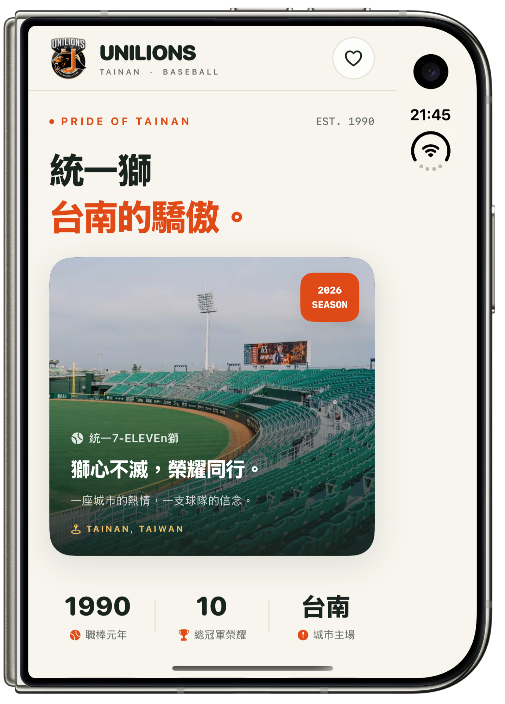
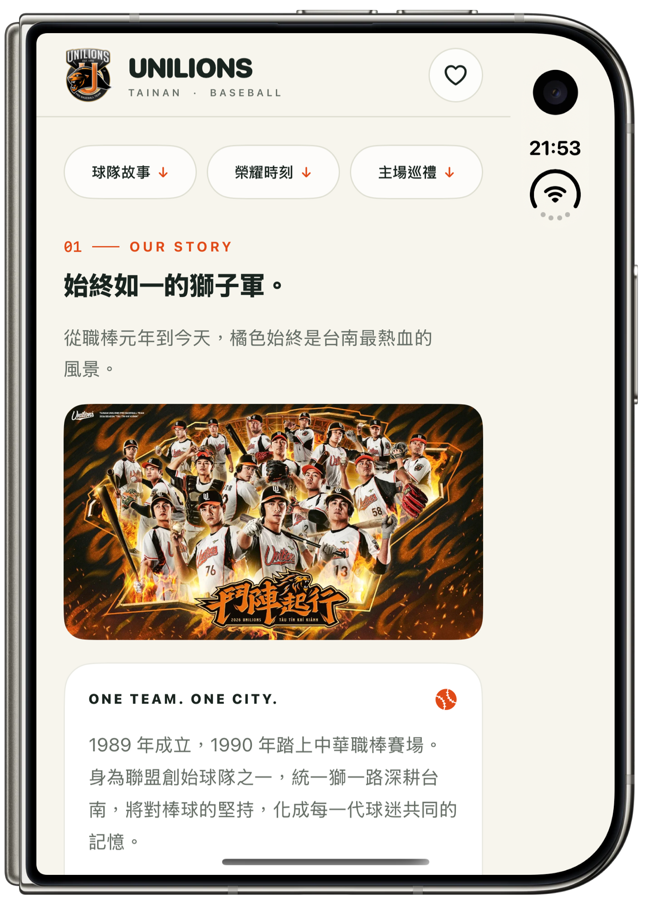
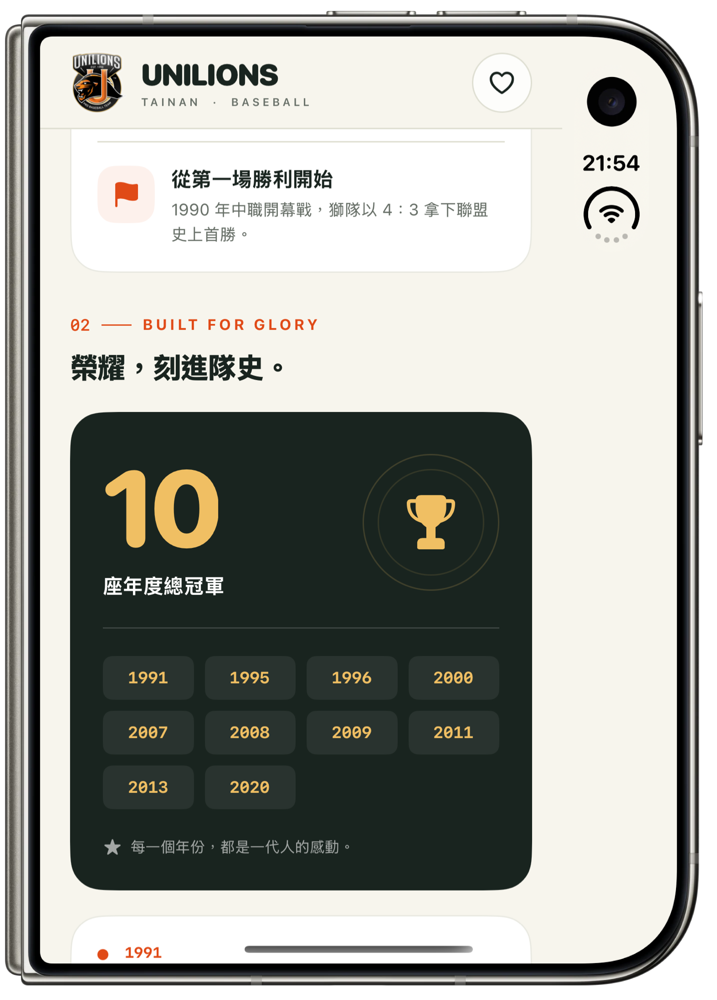
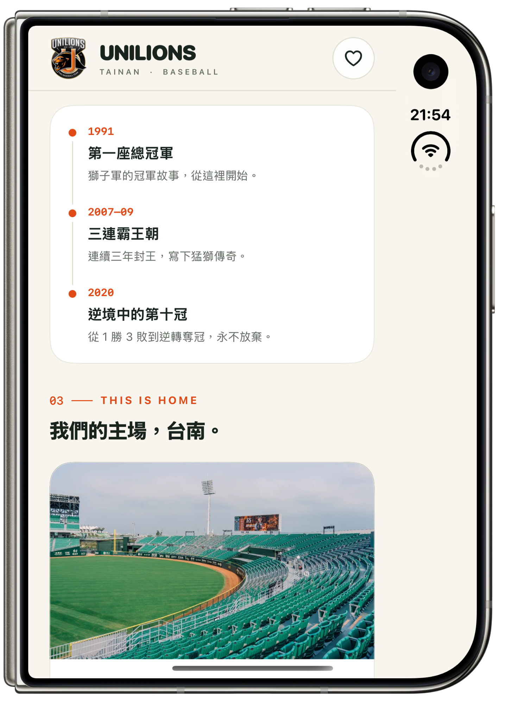
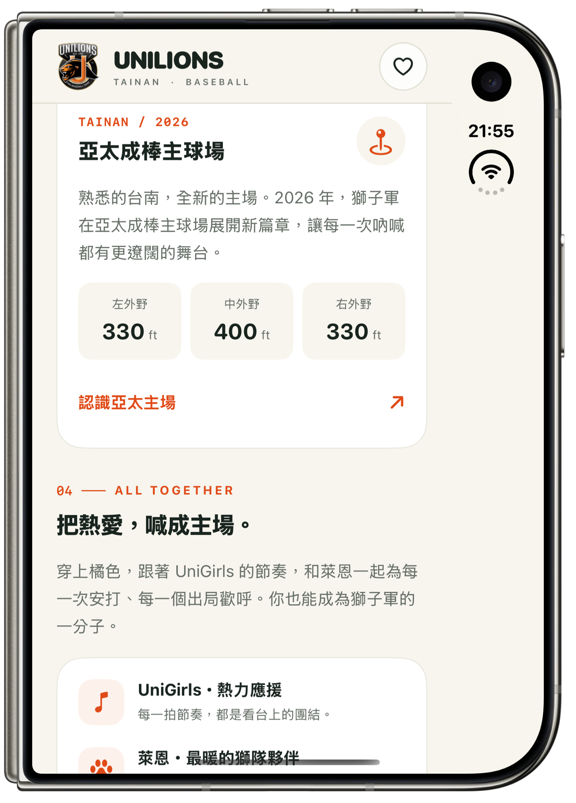
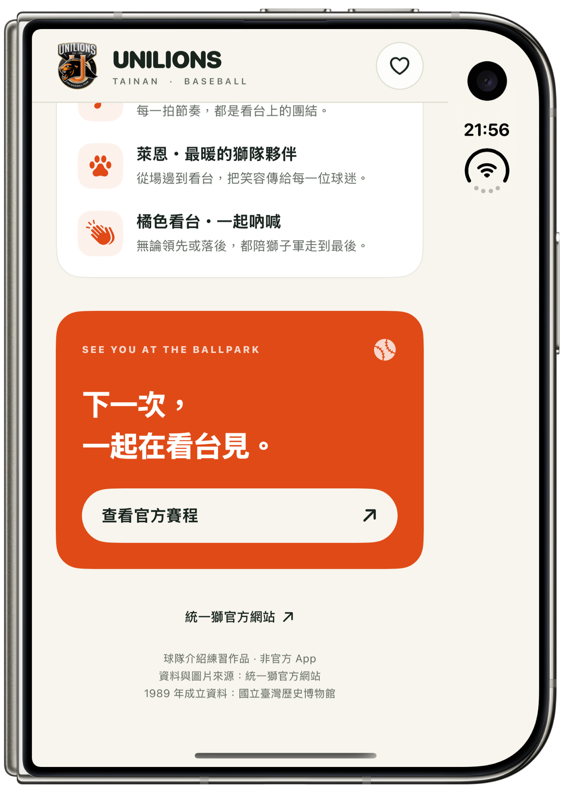

# 🦁 UniLions

**One team. One city. A SwiftUI tribute to Tainan's baseball pride.**

[English](#english) · [繁體中文](#traditional-chinese)

[](UniLions.xcodeproj/project.xcproj)
[](UniLions/ContentView.swift)

<a id="english"></a>

## English

UniLions is an unofficial, single-page SwiftUI app introducing the Uni-President 7-ELEVEn Lions. Team orange, warm cream, deep green, stadium photography, and an editorial layout bring the team's story, championship milestones, home ballpark, and fan culture into one vertically scrollable screen. The app's content is presented in Traditional Chinese.

### 📸 App tour

Six original iPhone Duo screenshots with device bezels, provided for this project. Click any screenshot to view the full-size image.

| Home & team identity | Team story | Championship collection |
| :---: | :---: | :---: |
| <a href="docs/screenshots/01-home.png"></a> | <a href="docs/screenshots/02-team-story.png"></a> | <a href="docs/screenshots/03-championships.png"></a> |

| Milestones & home ballpark | Stadium details & fan culture | See you at the ballpark |
| :---: | :---: | :---: |
| <a href="docs/screenshots/04-milestones.png"></a> | <a href="docs/screenshots/05-stadium-and-fans.png"></a> | <a href="docs/screenshots/06-ballpark-footer.png"></a> |

### Highlights

- **A complete team introduction:** team history, championship years, a milestone timeline, the Tainan home stadium, and cheering culture.
- **One continuous page:** vertical scrolling with shortcuts to the story, honors, and stadium sections.
- **A persistent favorite:** the heart button stores its state with `@AppStorage`.
- **Images available offline:** the team logo, team artwork, and stadium photograph are bundled in the asset catalog; icons use SF Symbols.
- **Reusable SwiftUI components:** small view types in separate files, customized through properties.
- **Official destinations:** links to the team's website, schedule, and stadium information.

### Quick start

**Requirements:** macOS with Xcode 27 or newer and an iOS 27+ SDK/runtime. The iOS app target has a minimum deployment version of 27.0; the project uses Xcode's `project.xcproj` format. No third-party package dependencies are declared.

```bash
git clone https://github.com/PeterPanSwift/UniLions.git
cd UniLions
open UniLions.xcodeproj
```

1. Select the **UniLions** scheme in Xcode.
2. Choose a compatible iPhone or iPad simulator.
3. Press **⌘R** to build and run, or open `ContentView.swift` to use its `#Preview`.

For a physical device, select your own development team under **Signing & Capabilities** and adjust the bundle identifier if needed. Bundled content works offline; opening the official links requires an internet connection.

### SwiftUI learning checklist

| Requirement | Implementation |
| --- | --- |
| `VStack`, `HStack`, `ZStack` | Screen sections, horizontal statistics, and layered hero content |
| `Text`, `Image` | Headlines, narrative text, asset images, and SF Symbols |
| `ScrollView` | Vertical screen composition in `ContentView` |
| Multiple modifiers | Typography, spacing, backgrounds, gradients, clipping, borders, and shadows |
| View types across multiple files | Dedicated hero, story, honors, stadium, and fan-culture views |
| Property-based customization | Text, image names, statistics, championship years, and callback properties |

For example, customize a section heading by passing its content:

```swift
TeamSectionHeading(
    number: "01",
    eyebrow: "OUR STORY",
    title: "始終如一的獅子軍。"
)
```

### Project guide

| File | Responsibility |
| --- | --- |
| [MyApp.swift](UniLions/MyApp.swift) | App entry point |
| [ContentView.swift](UniLions/ContentView.swift) | Page composition, scrolling, and section shortcuts |
| [LionsHeroView.swift](UniLions/LionsHeroView.swift) | Fixed brand header, favorite button, and stadium hero |
| [TeamComponents.swift](UniLions/TeamComponents.swift) | Reusable headings, statistics, navigation, and symbol features |
| [TeamStoryView.swift](UniLions/TeamStoryView.swift) | Team history and artwork |
| [TeamHonorsView.swift](UniLions/TeamHonorsView.swift) | Championship collection and milestone timeline |
| [HomeStadiumView.swift](UniLions/HomeStadiumView.swift) | Stadium introduction and field distances |
| [FanCultureView.swift](UniLions/FanCultureView.swift) | Cheering culture, schedule callout, and attribution footer |
| [LionsTheme.swift](UniLions/LionsTheme.swift) | Colors, section metadata, team facts, and card styling |
| [Assets.xcassets](UniLions/Assets.xcassets) | Bundled logo, team artwork, and stadium photo |

### Validation

The app was built and reviewed on an iPhone 18 Pro simulator. Fresh launch, favorite toggling, all three section shortcuts, and scrolling through the footer were verified. iPad and XXX Large Dynamic Type previews were also inspected. Additional review screenshots are in [Preview](Preview).

### Attribution

This is an unofficial learning project, independent of the UniLions organization. Team photographs, artwork, and trademarks belong to their respective owners. Source links and image attribution are preserved in [ASSET_SOURCES.md](ASSET_SOURCES.md). No software license is currently declared in this repository.

[繁體中文 ↓](#traditional-chinese)

---

<a id="traditional-chinese"></a>

## 繁體中文

[English ↑](#english)

UniLions 是介紹統一7-ELEVEn獅的非官方 SwiftUI 一頁式 App。以獅隊橘、奶油白、深綠與球場照片，搭配運動雜誌風格的排版，將球隊故事、冠軍里程碑、主場與應援文化串成可上下捲動的畫面。App 內容使用繁體中文呈現。

### 📸 畫面展示

以下六張為此專案提供的 iPhone Duo 原始外框截圖，點選圖片即可查看完整尺寸。

| 首頁與球隊識別 | 球隊故事 | 冠軍榮耀 |
| :---: | :---: | :---: |
| <a href="docs/screenshots/01-home.png"></a> | <a href="docs/screenshots/02-team-story.png"></a> | <a href="docs/screenshots/03-championships.png"></a> |

| 冠軍里程碑與主場 | 球場資訊與應援文化 | 下一次在看台見 |
| :---: | :---: | :---: |
| <a href="docs/screenshots/04-milestones.png"></a> | <a href="docs/screenshots/05-stadium-and-fans.png"></a> | <a href="docs/screenshots/06-ballpark-footer.png"></a> |

### 特色

- **完整球隊介紹：** 球隊歷史、冠軍年份、里程碑時間軸、台南主場與應援文化。
- **一頁式閱讀：** 支援上下捲動，可透過捷徑跳到球隊故事、榮耀與主場章節。
- **收藏狀態保存：** 愛心按鈕使用 `@AppStorage`，重新啟動後仍保留收藏狀態。
- **圖片離線顯示：** 隊徽、球隊主視覺及球場照片放在 Assets，圖示使用 SF Symbols。
- **可重用元件：** 各個 View 拆成獨立檔案，以 property 客製內容。
- **官方連結：** 提供球隊官網、賽程與球場介紹的連結。

### 快速開始

**環境需求：** macOS、Xcode 27 或更新版本，以及 iOS 27+ SDK／執行環境。iOS App target 的最低部署版本為 27.0，專案使用 Xcode 的 `project.xcproj` 格式，沒有宣告第三方套件相依。

```bash
git clone https://github.com/PeterPanSwift/UniLions.git
cd UniLions
open UniLions.xcodeproj
```

1. 在 Xcode 選擇 **UniLions** scheme。
2. 選擇相容的 iPhone 或 iPad 模擬器。
3. 按 **⌘R** 編譯並執行，或開啟 `ContentView.swift` 使用 `#Preview`。

若要在實體裝置執行，請在 **Signing & Capabilities** 選擇自己的開發團隊，並視需要調整 Bundle Identifier。內建內容可離線使用，開啟官方連結則需要網路。

### SwiftUI 學習需求對照

| 需求 | 實作方式 |
| --- | --- |
| `VStack`、`HStack`、`ZStack` | 垂直章節、橫向數據與主圖圖層 |
| `Text`、`Image` | 標題、敘述、Asset 圖片與 SF Symbols |
| `ScrollView` | 在 `ContentView` 組合可上下捲動的頁面 |
| 多個 modifier | 字體、間距、背景、漸層、裁切、邊框與陰影 |
| 使用多個檔案定義 View | 主圖、故事、榮耀、球場與應援各自拆分 |
| 使用 property 客製 View | 文字、圖片名稱、數據、冠軍年份與操作回呼 |

例如，透過傳入內容客製章節標題：

```swift
TeamSectionHeading(
    number: "01",
    eyebrow: "OUR STORY",
    title: "始終如一的獅子軍。"
)
```

### 專案導覽

| 檔案 | 職責 |
| --- | --- |
| [MyApp.swift](UniLions/MyApp.swift) | App 進入點 |
| [ContentView.swift](UniLions/ContentView.swift) | 頁面組合、捲動與章節跳轉 |
| [LionsHeroView.swift](UniLions/LionsHeroView.swift) | 固定品牌列、收藏按鈕與球場主圖 |
| [TeamComponents.swift](UniLions/TeamComponents.swift) | 可重用標題、數據、導航與圖示元件 |
| [TeamStoryView.swift](UniLions/TeamStoryView.swift) | 球隊歷史與主視覺 |
| [TeamHonorsView.swift](UniLions/TeamHonorsView.swift) | 冠軍年份與里程碑時間軸 |
| [HomeStadiumView.swift](UniLions/HomeStadiumView.swift) | 主場介紹與球場距離 |
| [FanCultureView.swift](UniLions/FanCultureView.swift) | 應援文化、賽程卡片與來源頁尾 |
| [LionsTheme.swift](UniLions/LionsTheme.swift) | 配色、章節資料、球隊資訊與卡片樣式 |
| [Assets.xcassets](UniLions/Assets.xcassets) | 隊徽、球隊主視覺與球場照片 |

### 驗證紀錄

已在 iPhone 18 Pro 模擬器完成編譯與畫面檢查，驗證重新啟動、收藏切換、三個章節跳轉及捲動到頁尾，也檢視了 iPad 與 XXX Large 動態字級預覽。其他驗證截圖保存在 [Preview](Preview)。

### 來源與權利

本專案為獨立的非官方學習作品。球隊照片、主視覺與商標權利屬原權利人；完整圖片與資料來源保留於 [ASSET_SOURCES.md](ASSET_SOURCES.md)。本 repository 目前沒有宣告軟體授權條款。

[回到 English ↑](#english)
